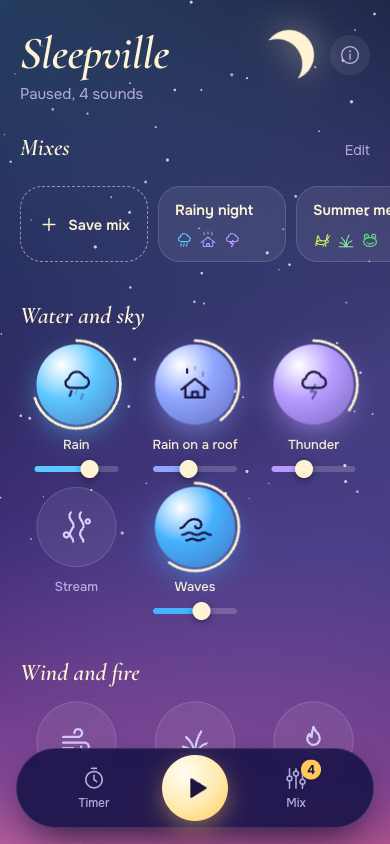

# Sleepville

A sleep-sounds mixer for Android. Pick any combination of sounds, set each one's volume, save the mix, start a sleep timer. Free, offline, no ads, no accounts, no data collection.



## What it does

- 23 looping sounds: rain, thunder, stream, waves, wind, campfire, birds, crickets, frogs, singing bowl, wind chimes, flute, piano, sitar, tanpura, sarod and more.
- Any combination plays at once, each sound with its own volume.
- Mixes are saved under a name and started with one tap. Six presets are built in; any mix can be deleted.
- Sleep timer for 1, 5, 10, 15, 20, 30 or 60 minutes. The sound fades out over the last ten seconds and the app closes.
- Keeps playing with the screen off. Play, pause and close from the notification. Pauses for a phone call and resumes after it.
- Russian and English interface; layouts for phones, foldables and tablets.

## Build

Requirements: Node 22, JDK 21, Android SDK (platform 36), ffmpeg (only for rebuilding sounds).

```sh
npm install
npm run dev        # web version at http://localhost:5199
npm run apk        # debug APK in android/app/build/outputs/apk/debug/
npm run sounds     # rebuild public/sounds/ from sounds-src/ (optional)
```

`npm run apk` needs `JAVA_HOME` pointing at JDK 21 and `ANDROID_HOME` at the SDK.

## How it is built

- UI: React, TypeScript, Vite, [Motion](https://motion.dev) for animation. Wrapped for Android with [Capacitor](https://capacitorjs.com).
- Audio: Web Audio. Short loops are decoded into memory and loop sample-exactly; long melodic tracks are streamed.
- Native part (`android/app/src/main/java/app/sleepville/`): a foreground service with a wake lock, the notification actions, call detection, and closing the app when the timer ends.
- Sounds are cut into seamless loops and level-matched by `scripts/build-sounds.mjs`. The piano melody is rendered from single-note samples by `scripts/make-lullaby.mjs`. The bamboo chimes are single knocks from a recording, re-spaced by `scripts/make-bamboo.mjs`.

[SPEC.md](SPEC.md) (in Russian) holds the requirements, the architecture and the state of work.

## Credits and licenses

The app code is under the [MIT license](LICENSE).

The sounds come from third parties under their own licenses (CC0, public domain, CC BY, Pixabay Content License). The full list with authors and sources is in [public/sounds/CREDITS.md](public/sounds/CREDITS.md) and in the app under About. Fonts: Onest and Cormorant Garamond, SIL Open Font License 1.1.

## Support

Sleepville is free and stays free. If it helps you fall asleep, you can say thanks on [Boosty](https://boosty.to/vibemycode/donate). Questions and ideas: [open an issue](https://github.com/VibeMyCode/Sleepville/issues).
